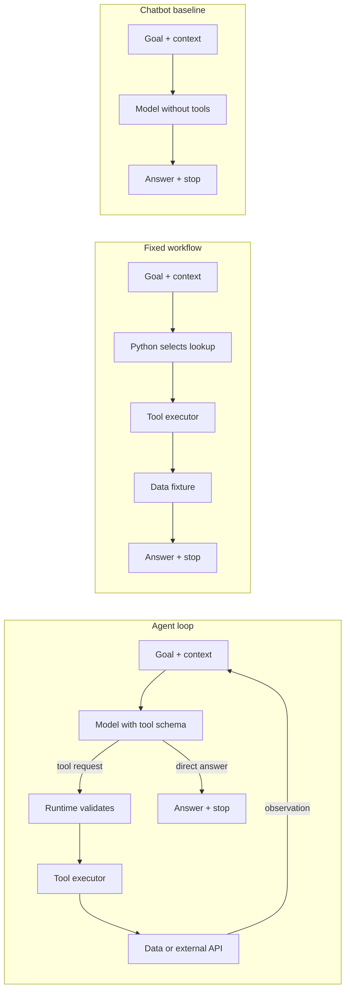
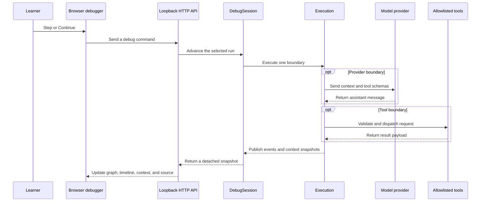

# Session 01 · Video 01 — From LLM to AI Agent

This is a runnable execution debugger, not a slide-based simulation. The
browser graph, event timeline, counters, context snapshots, and source inspector
are driven by the same Python runtime. Every **Step** advances one real runtime
boundary; provider and tool operations run only when execution reaches them.


## Start the debugger

Requires Python 3.11 or later. The default offline demonstration has no runtime
package dependencies, API key, or model service requirement.

```sh
python3 run.py
```

Open **http://127.0.0.1:8765**. If the port is busy, use
**python3 run.py --port 8766**. Stop the server with Ctrl+C. It binds to
loopback and is not a public web server.

## Follow a real execution

1. Keep **Agent loop** and **Offline · rule-based** selected for a repeatable
   classroom run. Choose the default company-summary goal.
2. Keep **Tool execution** selected under **Break before**, then select
   **Create paused run**. The run begins with no events, model calls, tool calls,
   or context messages.
3. Select **Step** to advance one runtime boundary. Select **Continue** to run
   until a selected breakpoint, a pause request, or the stop boundary.
4. At the tool breakpoint, inspect the structured request, call ID, and
   arguments. The tool has not run yet. Edit a declared argument to create an
   auditable debug-override event.
5. Step once to execute the allowlisted Python handler. Inspect its result and
   call ID. Step again to append the result to the model context.
6. Compare **Context → Before / After**. Open **Source** to see the Python
   method and line span for the selected or upcoming boundary.
7. Continue to the final response and stop event. Select earlier timeline rows
   to inspect history; selecting history never repeats a model or tool call.
   Export a JSON snapshot if you want to annotate the evidence.

**Step granularity:** each click advances one named runtime boundary, such as
context assembly, a provider call, tool execution, observation insertion, or
finalization. This is not an OS-level or line-by-line debugger. The source view
highlights the method responsible for the selected boundary.

The default breakpoint is before tool execution. Optional breakpoints can pause
before a provider call or before an observation enters context. **Pause** and
**Stop** take effect between boundaries. An in-flight provider request must
return before either command takes effect; Ollama requests time out after 60
seconds.

## What the three execution patterns show

Each mode has a different control path. The graph changes its nodes, edges, and
layout to match the operation that actually runs.



- **Agent loop:** the model proposes an action. Runtime code validates the
  request, executes an allowlisted handler, and returns the observation to the
  next model call.
- **Fixed workflow:** Python chooses and runs a prescribed document lookup.
  There is no model call in this prepared path.
- **Chatbot baseline:** the model receives context without tool specifications.
  It returns one response and cannot invoke the tool executor.

These names describe the prepared lesson paths. Real applications can combine
model choices with fixed steps and approvals.

## How the browser reaches Python code



Creating a paused run does not call a model or tool. Event evidence distinguishes
four stages: **tool schema** (capability description), **tool request** (model
proposal), **tool result** (executor outcome), and **observation** (result added
to context). Match the call ID and result before treating a request as a
successful operation.

## Source map

| File                            | Responsibility                                                           | Useful entry points                                                                                    |
| ------------------------------- | ------------------------------------------------------------------------ | ------------------------------------------------------------------------------------------------------ |
| `run.py`                        | Load local configuration and dispatch to the web debugger or CLI         | Argument parser, `--cli`, `--mode`, `--provider`, `--port`                                             |
| `src/agent_lab/runtime.py`      | Resumable execution state machine shared by CLI and debugger             | `Execution`, `step`, `_call_model`, `_execute_tool`, `_observation`, `_finalize`                       |
| `src/agent_lab/debugger.py`     | Own one run, breakpoints, commands, snapshots, and background stepping   | `DebugSession`                                                                                         |
| `src/agent_lab/providers.py`    | Shared model-message contract and provider adapters                      | `OfflineModel`, `OllamaModel`, `CloudflareModel`                                                       |
| `src/agent_lab/tools.py`        | Tool schemas, allowlist, argument validation, and handlers               | `TOOL_SCHEMAS`, `execute`, `tool_implementation`, `_search_documents`, `_search_weather`, `_calculate` |
| `src/agent_lab/architecture.py` | Node catalog, shared edges, and per-mode graph layouts                   | `NODES`, `EDGES`, `MODE_EDGES`, `MODE_VIEWS`                                                           |
| `src/agent_lab/server.py`       | Loopback HTTP API, static assets, and source allowlist                   | `Handler`, request routes                                                                              |
| `src/agent_lab/config.py`       | Read plain `KEY=value` settings from the lesson-local `.env`             | `load_env_file`                                                                                        |
| `src/agent_lab/network.py`      | Certificate-verifying HTTPS context                                      | `verified_https_context`                                                                               |
| `src/web/app.js`                | Send controls and render snapshots, graph, timeline, context, and source | `drawGraph`, `renderGraph`, `renderTimeline`, `renderInspector`                                        |
| `src/web/index.html`            | Accessible controls and debugger panel structure                         | Provider, mode, breakpoint, and inspector elements                                                     |
| `src/web/style.css`             | Responsive layout and visual states for modes and execution              | Graph, mode banner, timeline, and inspector styles                                                     |
| `tests/`                        | Test runtime, debugger controls, HTTP limits, and package documentation  | `python3 -m pytest`                                                                                    |

`architecture.py` is the diagram data source. `runtime.py` owns the operation;
`debugger.py` controls when it advances; `server.py` transports commands and
snapshots; `app.js` visualizes those snapshots. The browser does not calculate
the model response or replay a prerecorded event sequence.

## Tools and data boundaries

The lesson provides three allowlisted capabilities:

- `search_documents` searches four synthetic ExampleCo classroom records. It is
  keyword matching, not a RAG pipeline. The records do not describe R&D
  Technology JSC.
- `search_weather` resolves a place and fetches current conditions from fixed
  [Open-Meteo geocoding](https://open-meteo.com/en/docs/geocoding-api) and
  [forecast](https://open-meteo.com/en/docs) HTTPS endpoints.
- `calculate` evaluates bounded arithmetic from a restricted Python syntax
  tree in the local process.

The model cannot select a URL or run arbitrary Python, shell, filesystem, or
tools. A weather request occurs only when execution crosses the tool boundary;
loading the page or creating a run sends no weather request. Use **Weather ·
Hanoi** and **Calculate** to inspect different tool contracts. For weather,
select the result event and open **Source** to see the registered handler in
`tools.py`.

## Optional real model providers

The default **Offline · rule-based** provider is deterministic application
logic, not LLM inference. It is useful for repeatable control-flow demos. The
optional Ollama and Cloudflare providers send real model requests and never
fall back to the offline provider when an error occurs.

The launcher reads a lesson-local `.env` file. Copy `.env.example` to `.env`
when configuring another checkout. Shell variables override `.env` values. The
root `.gitignore` excludes `.env`; never put a real token in `.env.example` or
an exported trace.

### Cloudflare Workers AI

Select **Cloudflare Workers AI · hosted LLM**. The default model is
`@cf/zai-org/glm-4.7-flash`, which supports multi-turn tool calling. Configure
`CLOUDFLARE_ACCOUNT_ID`, `CLOUDFLARE_API_TOKEN`, and optionally
`CLOUDFLARE_MODEL` in `.env`. Use a narrowly scoped Workers AI token. The
provider sends conversation context, tool schemas, and tool observations to
Cloudflare. As of October 2026, the documented free allocation is 10,000
Neurons per day; Workers Paid usage above that allocation is billed. Verify the
[current Workers AI pricing and quota](https://developers.cloudflare.com/workers-ai/platform/pricing/)
and [GLM-4.7-Flash model details](https://developers.cloudflare.com/workers-ai/models/glm-4.7-flash/)
before recording, since availability and billing can change.

The offline lab itself has no runtime dependencies. Install the optional
certificate bundle only if Cloudflare or weather requests fail because the
Python installation lacks system CA roots:

```sh
python3 -m pip install -r requirements-cloudflare.txt
```

The live provider request occurs only at **Call model provider**.

### Ollama local model

Ollama demonstrates real local inference. The suggested lesson model is
`qwen3:8b`; it must support tool calls.

```sh
ollama serve
ollama pull qwen3:8b
export OLLAMA_MODEL=qwen3:8b
python3 run.py
```

Select **Ollama · real local LLM** before creating a new run. A missing service,
model, or tool-call capability appears as a provider error. The trace
demonstrates observed behavior; it does not claim answer quality.

## Run the same engine from a terminal

```sh
python3 run.py --cli --prompt "Summarize the company AI capabilities."
python3 run.py --cli --mode workflow --prompt "How does the company evaluate quality?"
python3 run.py --cli --mode chatbot
python3 run.py --cli --fault no_executor
```

The CLI drains the same resumable engine to completion and prints JSON. A
successful run exits with code 0; a runtime failure exits with code 2.

## Verify the package

```sh
python3 -m pip install -r requirements-dev.txt
PYTHONPATH=src python3 -m pytest -q
python3 -m black --check run.py src/agent_lab tests
npx --yes prettier@3.9.6 --check \
  ../../../README.md README.md docs/*.md examples/README.md exercises/README.md \
  presentation/README.md src/web/app.js src/web/index.html src/web/style.css
node --check src/web/app.js
```

The offline traces in [examples/](examples/README.md) are generated from the
same runtime.

## Lesson material

1. [Runtime architecture and code flow](docs/ARCHITECTURE.md)
2. [Video and slide alignment](docs/VIDEO_ALIGNMENT.md)
3. [Eight-minute debugger runbook](docs/DEMO_RUNBOOK.md)
4. [Learner exercises](docs/EXERCISES.md)
5. [Verification and limits](docs/VERIFICATION.md)
6. [Presentation guide](presentation/README.md)

All lesson guides and source comments are written in English.
