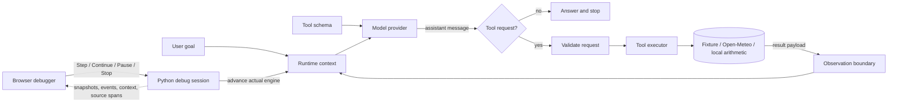

# Runtime architecture and debugger

## Live execution path

The browser map is built from the architecture module. The Python engine owns
execution; the browser reads snapshots and sends explicit control commands.

**Architecture comment:** LLM + Context + Tools + Runtime + Environment is a
teaching decomposition. The model proposes; the application owns validation,
execution, state changes, and stopping. The tool schema describes a capability
but does not contain its executable implementation.

## One boundary per Step

Execution is a resumable state machine shared by the CLI and the debugger.
Constructing it validates configuration but does not call a provider or tool.
The next-action view describes the next real operation and its source span
without prefetching the operation. A Step runs that boundary and records its
event with detached before and after context snapshots.

A DebugSession adds explicit control around that engine:

- **Step** advances one named boundary.
- **Continue** advances until a selected breakpoint, a stop, or a pause.
- **Pause** requests a stop after the current boundary returns.
- **Stop** requests cancellation after the current boundary returns.
- **History selection** reads already published events; it cannot advance the engine.

Breakpoints are checked before a model call, tool execution, or observation
insertion. The default breakpoint is before tool execution, so a learner can see
the pending request before the document handler runs. Each published snapshot
is copied while holding a short lock; slow local model I/O does not block reads
or prevent a pause request.

**Step granularity:** the controls step runtime boundaries implemented by
methods in the execution module, not individual machine instructions or every
Python source line. The Source inspector loads allowlisted files and highlights
the method's actual line span. It does not evaluate or execute code from the
browser.

## Tool calling and evidence

The lesson distinguishes four events that are easy to conflate:

| Evidence     | What it demonstrates                                                     |
| ------------ | ------------------------------------------------------------------------ |
| Tool specs   | The runtime made a capability description available.                     |
| Tool request | The assistant proposed a named action and arguments. No handler ran yet. |
| Tool result  | The trusted executor returned a result or rejection for that call ID.    |
| Observation  | The runtime appended the result as a tool-role context message.          |

A request is not evidence that a lookup succeeded. Compare the matching call
ID, result payload, and later context state. The debugger's argument editor is
derived from the pending tool schema. It adds a debug-override event and
preserves the original model request for comparison.

The ReAct view is the externally observable sequence of proposal, action, and
observation. The lab never presents private model reasoning as a trace.

## Model provider and environment

The provider module exposes one assistant-message contract. The default offline
provider uses explicit deterministic rules and can choose a direct response or
one of the registered tool requests. It does not use learned model weights. The
optional Ollama provider sends the current context and tool schemas to a fixed
local endpoint. Provider failure is recorded; the runtime does not substitute
the offline provider.

The tools module owns the allowlist and validates every argument before
dispatch. `search_documents` reads four synthetic classroom records;
`search_weather` resolves a place and reads current conditions from fixed
Open-Meteo HTTPS endpoints; `calculate` evaluates a bounded arithmetic AST in
the local process. There is no shell, filesystem, arbitrary URL, or arbitrary
tool execution. Weather input is a place name rather than a URL, outbound calls
have an eight-second timeout and bounded response size, and a weather lookup is
performed only at the stepped executor boundary. The document lookup is a small
keyword fixture, not RAG or a production retrieval system.

## Compare execution patterns

| Pattern          | Who chooses the next action?        | Lesson behavior                                                                  |
| ---------------- | ----------------------------------- | -------------------------------------------------------------------------------- |
| Agent loop       | Model proposes within runtime rules | The model can request document search, weather, arithmetic, or return an answer. |
| Fixed workflow   | Python application code             | Code performs one prepared search without a model call.                          |
| Chatbot baseline | Model, without exposed tools        | One response uses the supplied prompt and context.                               |

These patterns are labels for the prepared examples, not mutually exclusive
product categories. A real application can combine model choices with fixed
steps and approvals.

## Source map

| Concept                                                     | Source                          | Inspect                                                                       |
| ----------------------------------------------------------- | ------------------------------- | ----------------------------------------------------------------------------- |
| Web and CLI entry points                                    | `run.py`                        | Argument parser, local `.env` loading, `run`, `serve`                         |
| Input, model input, tool request, observation, and stop     | `src/agent_lab/runtime.py`      | `Execution.step`, `_call_model`, `_execute_tool`, `_observation`, `_finalize` |
| Live control, breakpoints, snapshots, and in-memory history | `src/agent_lab/debugger.py`     | `DebugSession`                                                                |
| Provider contract and adapters                              | `src/agent_lab/providers.py`    | `OfflineModel`, `OllamaModel`, `CloudflareModel`                              |
| Certificate-verifying HTTPS context                         | `src/agent_lab/network.py`      | `verified_https_context`                                                      |
| Tool contract, validation, and handlers                     | `src/agent_lab/tools.py`        | `TOOL_SCHEMAS`, `execute`, `tool_implementation`                              |
| Diagram nodes, mode layouts, and connections                | `src/agent_lab/architecture.py` | `NODES`, `EDGES`, `MODE_EDGES`, `MODE_VIEWS`                                  |
| Loopback API and source allowlist                           | `src/agent_lab/server.py`       | `Handler` and request routes                                                  |
| Graph, timeline, context, and source inspector              | `src/web/app.js`                | `drawGraph`, `renderGraph`, `renderTimeline`, `renderInspector`               |
| Browser controls and accessible panel structure             | `src/web/index.html`            | Form controls, graph, timeline, and inspector panels                          |
| Responsive layout and visual execution states               | `src/web/style.css`             | Mode-specific graph and debugger styles                                       |

The browser sends explicit commands to `server.py`. The server delegates them
to `DebugSession`, which advances `Execution.step()` and returns a copied
snapshot. `app.js` renders that snapshot; it does not implement agent behavior
or replay a canned trace. `architecture.py` supplies the node and edge catalog
used to draw and relayout each execution pattern.

## Local service boundary

The web server binds to 127.0.0.1, checks Host and browser Origin, bounds JSON
request bodies, and serves assets and source files through fixed allowlists.
Session IDs are opaque and sessions are held only in process memory. Idle
sessions expire after one hour when a new session is created; the server keeps
at most 32 sessions. Restarting it clears this temporary run history.

This is a teaching server without authentication, persistent storage, rate
limiting, multi-user isolation, or production deployment guarantees.

## Tool sources and external data

The tool catalog is visible under **Tools / Data** in the browser. Selecting a
completed tool-result event and opening **Source** highlights the actual
registered handler. For weather, the location query and current-conditions
request use fixed Open-Meteo HTTPS endpoints documented in the
[geocoding API reference](https://open-meteo.com/en/docs/geocoding-api) and
[forecast API reference](https://open-meteo.com/en/docs); the model cannot
provide a URL or host. The result includes the matched place, observation time,
weather values, and source name. The debugger pauses before network I/O, so the
pending request can be reviewed or edited before the API is contacted.
